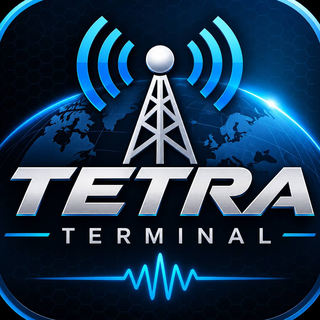
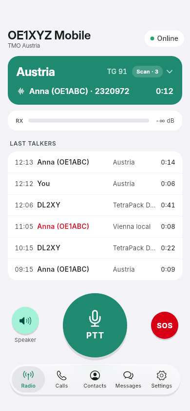
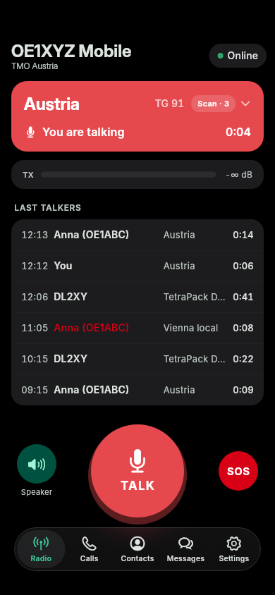
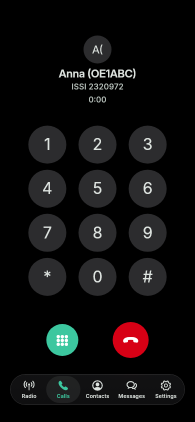
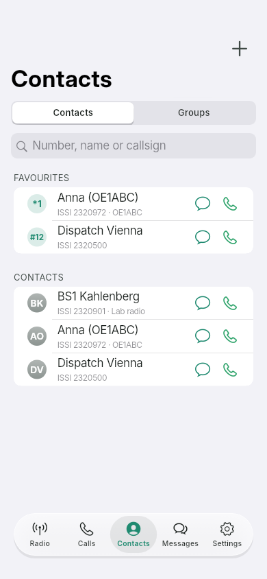
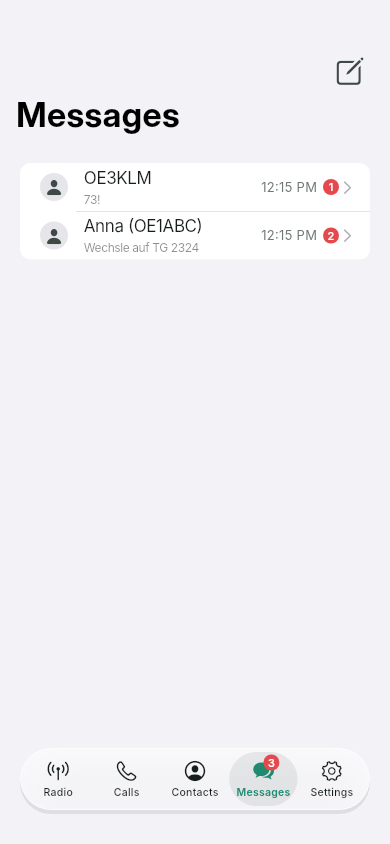
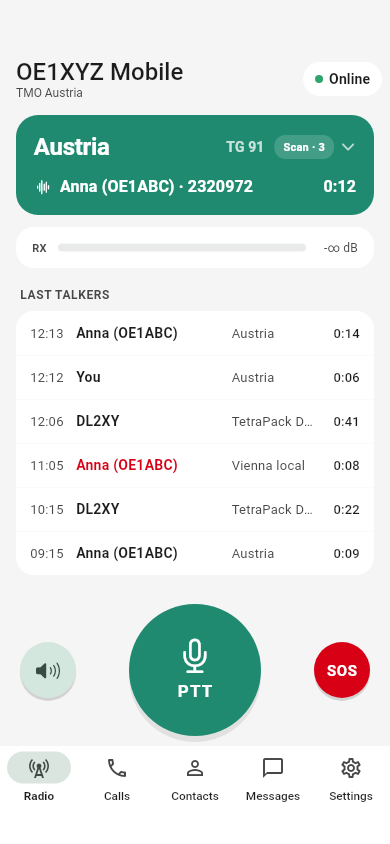
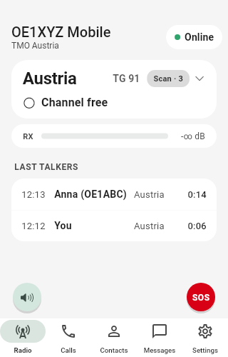
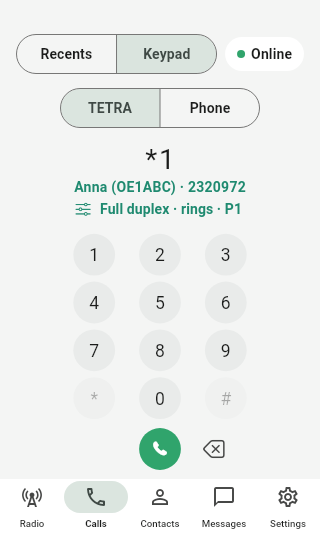

<p align="center">
  
</p>

<h1 align="center">TETRA Terminal</h1>

<p align="center">
  Your phone or PoC radio as a TETRA terminal.<br>
  Group calls with push-to-talk, private calls, text messages and location,
  over the Brew (TETRA Homebrew) protocol.
</p>

<p align="center">
  <a href="https://github.com/sebastianmadl/TetraTerminal/actions/workflows/ios.yml"></a>
  <a href="https://github.com/sebastianmadl/TetraTerminal/actions/workflows/android.yml"></a>
</p>

<p align="center">
  
  
  
  
  
</p>

TETRA Terminal runs on iPhones, Android phones and Android PoC radios such as
the Hytera P60. It connects to a
[brew-server](https://github.com/ysamouhos/brew-server) and logs in as a
Terminal, the same way a radio behind a base station does, and stays
compatible with TetraPack servers. Everything protocol, call and codec related
lives in a shared Rust core, so both platforms behave the same.

The original app was written by [ysamouhos](https://github.com/ysamouhos)
(up to 1.3.0). From 1.4.0 on it was rebuilt and extended in this fork by
[sebastianmadl](https://github.com/sebastianmadl) (OE4SXM). What changed in
each version is in [CHANGELOG.md](CHANGELOG.md).

## What it does

**Radio**
- Group calls with push-to-talk: on-screen button (hold or toggle), a
  headset key or the hardware PTT key of a PoC radio.
- Talkgroup list with scan. A scanned group is held after the call so PTT
  answers there.
- Emergency call (SOS), call priorities and pre-emption.
- Who is talking, with callsign names from your contacts, from the radio or
  from the RadioID.net list, and the last talkers on the radio screen.

**Calls**
- Private calls, full or half duplex, ringing or direct.
- An incoming call rings like a phone call: the system call screen on iOS, a
  full-screen call on Android.
- Phone-style keypad, call log, and speed dial for favourites (`*1`).
- Phone calls through the server's SIP gateway.

**Messages and location**
- Text messages (SDS) to radios and groups with delivery reports and flash
  messages, kept across restarts, with a tone, a notification and unread
  counters.
- LIP location reports, sent and received, also in the background.

**Contacts**
- Own contacts with favourites; one search across your contacts and the
  RadioID.net callsign list, with a call and a message button on every row.

**Made for daily use**
- Several connection profiles (servers and ISSIs), switched with one tap.
- Runs in the background: calls come in with the screen locked. On iOS a Live
  Activity shows group and talker on the Lock Screen and in the Dynamic
  Island.
- Audio tuned for radio: automatic transmit level, noise suppression, receive
  level control.
- Light and dark, German and English.

### On Android and PoC radios

<p align="center">
  
  
  
</p>

On a PoC radio the app uses the hardware PTT key, the channel knob (it
announces the chosen group) and the status LED, and the layout fits the small
display. The Hytera P60 works without teaching keys.

The pictures are rendered from the app's code with sample data
(`flutter test test_screenshots --update-goldens`).

## Status

| Feature | Status |
|---|---|
| Brew connection: HTTP Digest discovery, session path, WebSocket `brew` sub-protocol, `X-Brew-Mode: Terminal`, Brew v1 | ✅ live-tested |
| Register / re-register / deregister, affiliate / de-affiliate talkgroups | ✅ live-tested |
| Group calls, half duplex PTT, talker name (SS-TPI mnemonic) | ✅ live-tested |
| Private calls, full duplex, hook (ring + answer) | ✅ live-tested |
| Private calls, half duplex, direct (no answer) | ✅ live-tested |
| Call priority 0–15, emergency (15), pre-emption | ✅ live-tested |
| Text SDS, private and group, SDS-TL delivery reports, flash messages | ✅ live-tested |
| LIP short location reports via SDS (send and receive) | ✅ live-tested |
| TETRA ACELP voice (ETSI EN 300 395-2), STE framing | ✅ live-tested |
| Talkgroup list with scan, DTMF in private calls | ✅ in app |
| Savox BTH-101 Bluetooth PTT headset (Android: SPP PTT, SCO audio, volume) | ✅ live-tested |
| Connection profiles (several servers / ISSIs), passwords in the keychain | ✅ in app |
| Contacts with search across the RadioID.net list, favourites and speed dial (`*1` on the keypad), call log | ✅ in app |
| Server extensions when offered: `mni` (Multi Network), `group-access` | ✅ in app |
| Radio screen with scan hold, level meter, last talkers | ✅ in app |
| Voice codec fix (bit-exact ACELP encoder) and audio chain around the codec, see [below](#voice-codec-and-audio-chain) | ✅ in app |
| iOS: Live Activity, Dynamic Island, widget, background audio, own microphone capture | ✅ in app |
| PoC radios (Hytera P60): hardware PTT key, channel knob, status LED | ✅ in app |
| Incoming private calls ring like a phone call (iOS CallKit, Android call notification), ring tone choice | ✅ checked on a device |
| Messages: new-message search, tone and notification, unread counters, kept across restarts | ✅ checked on a device |
| German and English | ✅ in app |

"Live-tested" means two instances of the client exchanged it through a real
brew-server, with Digest auth on (8/8 scenarios, no
server warnings).

## Voice codec and audio chain

What differs from the original app (up to 1.3.0), in the order the audio
takes.

### The codec itself

The voice codec is the ETSI TETRA ACELP reference code (EN 300 395-2),
vendored in `tetra_core/third_party/tetra-codec`, the same code brew-server
uses. Two functions of it were changed, nothing else:

- **`L_add` and `L_sub`** (`source/tetra-codec-impl.c`) add and subtract in
  unsigned 32 bit instead of signed. The reference code adds in signed
  32 bit and tests for the overflow afterwards. Signed overflow is undefined
  in C, so clang at `-O2` (Xcode, Android NDK) removed the saturation. The
  encoder then produced a bitstream that differs from the reference, and a
  radio played it as short full-scale bursts around 2.7 kHz (the "chirp" on
  transmit). The result of the two functions is the same as in the
  reference.
- The codec is built with **`-fwrapv`** (`tetra_core/build.rs`) as a second
  guard for the rest of the reference code.
- A test (`encoder_is_bit_exact_with_the_reference_build` in
  `tetra_core/src/codec.rs`) encodes a fixed signal and compares the
  bitstream with the one of the reference built with gcc `-O0`.

The decoder and the 60 ms STE framing are unchanged.

### Before the encoder (transmit)

| Step | Original | Now |
|---|---|---|
| Microphone | `record` plugin at 16 kHz, decimated to 8 kHz | the same on Android; on iOS an own capture (`app/packages/tetra_mic`) whose converter is rebuilt when the audio hardware changes mid-recording |
| High-pass | none | 4th-order Butterworth at 300 Hz, the lower edge of TETRA speech |
| Noise suppression | none | speexdsp preprocessor in the Rust core (`tetra_core/src/denoise.rs`), denoiser only, switchable, off by default (on in the PoC radio preset) |
| Level | fixed gain and a look-ahead limiter | automatic level control to about -24 dBov that only follows speech, with the gain setting as a trim; a manual mode uses the gain alone. The limiter stays |
| Pacing | one frame every 60 ms as soon as it is encoded | frames are held before sending starts and after an underrun (240 ms by default, 180 ms to about 1 s), and queued frames are dropped when the call ends |

speexdsp is vendored unmodified in `tetra_core/third_party/speexdsp`
(BSD licence).

### After the decoder (receive)

| Step | Original | Now |
|---|---|---|
| Level | none | level control to a target (-21 dBov by default) with 30 ms look-ahead, a maximum level and an optional boost |
| Sample rate | 8 kHz handed to the system | on iOS converted to 48 kHz in the app (polyphase windowed-sinc, cut-off 3.4 kHz) |
| Output | call volume | media volume for group calls and PTT; the voice-call mode only in full-duplex calls. Loudspeaker / earpiece switch |

"Record my transmissions" under Settings > Audio saves the microphone signal
and the encoder input as WAV, to check the chain.

## Layout

```
tetra_core/      Rust: everything protocol, call and codec related (shared by both platforms)
  src/protocol.rs   Brew wire format (mirrors brew-server's protocol.rs byte for byte)
  src/calls.rs      Call engine: group/private, simplex/duplex, priority, pre-emption, timers
  src/sds.rs        SDS-TL text (Latin-1, ISO 8859-7 Greek, UCS-2), reports, LIP encode/decode
  src/codec.rs      ACELP encoder/decoder + 60 ms framing (vendored ETSI codec, same as server)
  src/transport.rs  Digest auth, discovery, TLS (rustls + ring), WebSocket upgrade
  src/client.rs     The running terminal: reconnect, re-registration, SDS bookkeeping, audio
  src/control.rs    Basestation control channel (hidden in the app)
  src/denoise.rs    Transmit noise suppression (speexdsp)
  src/api.rs        Flat API for flutter_rust_bridge
  tests/            Unit tests + end-to-end test against a mock Brew server
  examples/live_two_terminals.rs   Live test against a real brew-server
app/             Flutter UI (Radio, Calls, Messages, Contacts, Settings)
  lib/model/        TerminalModel, settings, contacts
  lib/screens/      One file per tab, connection form, settings pages
  lib/services/     Audio in/out, level control, call alerts, location
  lib/ui/           Shared widgets, theme, German texts (l10n_de.dart)
  tool/             setup.sh, Android variant switch, iOS ring tones
  ios_widgets/      Live Activity and widget extension
  packages/
    headset_ptt/    Android: Bluetooth headset PTT over SPP, SCO routing
    poc_ptt/        Android: PoC radio PTT key, knob, LED, background key service
    tetra_call/     Incoming call ringing (CallKit / Android), message alerts
    tetra_live/     Live Activity (iOS), status notification and service (Android)
    tetra_mic/      iOS microphone capture
```

All TETRA logic lives in Rust, so Android and iOS behave identically. The
Flutter side only moves 8 kHz PCM between the mic/speaker and the core.

## Build (Android)

Prerequisites: Flutter ≥ 3.22, Android Studio with the NDK, Rust via rustup.

```bash
cd app
./tool/setup.sh        # one time: platform folders, Rust bridge, permissions, bindings
flutter run            # with an Android phone attached
```

### Download

Finished builds are on the
[Releases page](https://github.com/sebastianmadl/TetraTerminal/releases),
with a note on which file is for which device. The iPhone build is unsigned
and has to be sideloaded.

### Builds from GitHub Actions (no Mac needed)

`.github/workflows/android.yml` and `ios.yml` build the app on every push to
`main`, or by hand from the Actions tab for any branch. The files download as
they are:

| File | For |
|---|---|
| `TetraTerminal-<version>.apk` | Android phones (all CPU types) |
| `TetraTerminal-<version>-arm64.apk`, `-arm32.apk` | the same, smaller, one CPU type each |
| `TetraTerminal-<version>-poc.apk` | PoC radios (with the background key service for the PTT key) |
| `TetraTerminal-<version>.ipa` | iPhone: install with Sideloadly or AltStore, signed with a free Apple ID (re-sign every 7 days) or your own certificate |
| `TetraTerminal-simulator` | `Runner.app` for the iOS Simulator |

The normal APKs leave out the Accessibility key service, because Google Play
Protect blocks sideloaded apps that declare one. Use the `-poc` file only on
PoC radios.

Android test builds are signed with a fixed key when the repository has the
secrets `ANDROID_KEYSTORE_BASE64`, `ANDROID_KEYSTORE_PASSWORD`,
`ANDROID_KEY_ALIAS` and `ANDROID_KEY_PASSWORD`; then each build installs over
the previous one. Without them every run signs with its own debug key and
Android refuses the update. `release.yml` builds both platforms, tags the
commit and publishes a GitHub Release.

### First run

Choose the language, then tap the connection pill at the top and add a
connection: server URL (e.g. `https://your-host:9000/brew/`), the username and
password from `[auth.users]` in `brew-server.toml`, your ISSI and your call.
Add talkgroups (GSSIs) under **Contacts > Groups**.

## Tests

```bash
cd tetra_core
cargo test                                   # unit tests + end-to-end session against a mock server

# against a running brew-server with two [auth.users] entries:
cargo run --example live_two_terminals -- http://127.0.0.1:9100/brew/ 2040001:pw1 2040002:pw2 91

cd ../app
flutter analyze --no-fatal-infos
flutter test                                 # app logic and widgets
flutter test test_screenshots --update-goldens   # renders the screens to PNG
```

## Protocol notes

* **Spec sources**: TetraPack Brew specification; brew-server `src/protocol.rs`
  as ground truth for layouts (v1 `mnemonic[34]` on `GROUP_TX` and
  `SETUP_REQUEST` only, 2-byte `CONNECT_CONFIRM`, 58-byte `SHORT_TRANSFER`,
  36-byte STE voice payload carrying two 137-bit ACELP subframes).
* **Private calls** follow FlowStation semantics as documented in
  brew-server: `SETUP_REQUEST` → `SETUP_ACCEPT` + `CALL_ALERT` →
  `CONNECT_REQUEST` (answer) → `CONNECT_CONFIRM`. `method=1` rings,
  `method=0` connects directly. `duplex=1` keeps both microphones live.
* **Half-duplex private floor**: the talker sends `SIMPLEX_GRANTED` on PTT
  and `SIMPLEX_IDLE` on release; the other side treats a received
  `SIMPLEX_GRANTED` as "peer talking".
* **Priority**: ETSI 4-bit call priority. 12–14 are pre-emptive, 15 is
  emergency. Higher number wins (brew-server's `higher_priority_number_wins`).
  The server pre-empts group floors; the client also pre-empts its own
  lower-priority private call for a pre-emptive incoming call, and picks
  which call's audio to play by priority.
* **SDS**: text uses PID 0x82 (0x89 for flash) with SDS-TL; reports are
  requested for private messages only. LIP uses PID 0x0A short location
  reports (76 bits), validated against the live Athens beacon in
  brew-server's tests.

## Known gaps / next steps

* **Device tests open** for the newest features, see the notes in
  [CHANGELOG.md](CHANGELOG.md) (Back / Quit app on Android, Play Protect
  with the phone APK, contacts search and speed dial). Calls and messages
  were checked on a device on 2026-11-27.
* **Android cannot bring the app to the front by itself** while the phone is
  unlocked and the app is in the background; a call shows as a heads-up
  notification there.
* **Half-duplex private floor against real radios**: verified client-to-client
  through brew-server. Whether a Basestation-attached radio uses the
  `SIMPLEX_GRANTED`/`SIMPLEX_IDLE` grant fields the same way is unverified.
* **ACELP codec licensing**: the vendored ETSI reference codec comes from the
  brew-server repo. Check ETSI's IPR terms before publishing to an app store.

## Credits

* [ysamouhos](https://github.com/ysamouhos): original app and Rust core,
  brew-server.
* [sebastianmadl](https://github.com/sebastianmadl) (OE4SXM): rebuild from
  1.4.0 on (interface, iOS, audio chain, PoC radios, calls, messages).
